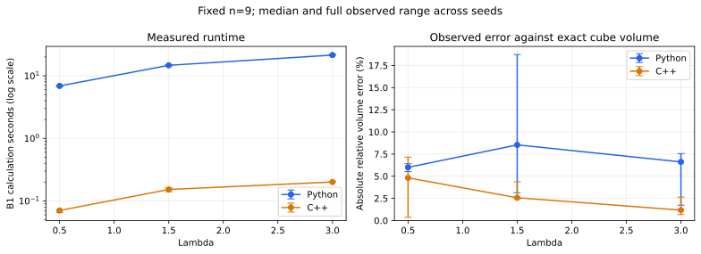
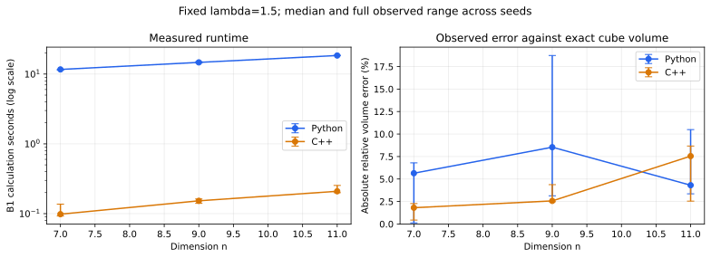

# Mixed Volume Approximations

I explore my mixed-volume oracle framework through numerical experiments with a centered cube and a Euclidean ball. I implement B1, B2, B3, and Algorithms 1–3 in Python and C++. I compare estimates with exact cube formulas and study measured runtime as lambda and dimension change.

$$
P=[-1,1]^n,\quad B=B_2^n,\quad
\operatorname{Vol}(P+\lambda B)=\sum_{i=0}^{n}\binom{n}{i}M_i\lambda^i.
$$

I use a side-length-2 cube, not a side-length-1 cube. My lambda is any nonnegative real number. My component index is codimension: in dimension 3, labels 0–3 correspond to cube interior, face, edge, and vertex projection regions.

## My theoretical framework and practical experiment

My theoretical framework is formulated under specified ideal-oracle assumptions. In this repository I explore what I can compute when I replace that access with finite random walks and floating-point calculations. I have not established that these numerical implementations satisfy the ideal sampling and accuracy assumptions. I do not use these experiments to assess the validity of my theorem or its proof.

For the cube I compute projection explicitly by clipping. My practical difficulties concern finite burn-in, correlated observations, approximate chord endpoints, label decisions near boundaries, and uncertainty in estimated phase ratios. I do not claim that the assumed oracles are impossible to implement. I have not built a certified implementation of their full guarantees here.

| Component | What I implement |
|---|---|
| Algorithm 1 / B2 | A continuing hit-and-run chain, cube projection, and one integer label |
| B3 | Counts and empirical probabilities from repeated calls to that chain |
| B1 | Nested-body volume ratios estimated from hit-and-run samples |
| Algorithm 2 | Experimental geometric search for a useful lambda |
| Algorithm 3 | A volume estimate and fresh label probabilities combined to recover a mixed-volume coefficient |

## My files

- [Python experiment notebook](notebooks/mixed_volume_python.ipynb): explanations, equations, inputs, limitations, example output, and charts.
- [C++ experiment notebook](notebooks/mixed_volume_cpp.ipynb): compilation, settings, recorded output, and explanation of the C++ experiment.
- [C++ source](cpp/mixed_volume_experiment.cpp): interactive implementation and machine-readable B1 benchmark mode.
- [Python/C++ comparison notebook](notebooks/python_cpp_comparison.ipynb): reproducible benchmark controls and two-panel plots.
- [Python module](python/mixed_volume.py): reusable numerical definitions.
- [Benchmark runner](benchmarks/run_comparison.py): matched B1 settings across languages.
- [Raw measurements](results/comparison.csv) and [environment details](results/benchmark_environment.json).

## How I run the Python notebooks

I create the environment from the repository root:

```bash
conda env create -f environment.yml
conda activate convex-walks
python -m ipykernel install --user --name convex-walks --display-name "Python (convex-walks)"
jupyter lab
```

I open a notebook, select the compatible kernel, and run cells from top to bottom. The Python experiment explains every input before asking for it. If I change settings, I restart and run all cells. Other users can use a differently named kernel with compatible dependencies; they do not need my local kernel name.

If an older Matplotlib build fails with NumPy 2 in another environment, I select this environment instead of modifying that unrelated installation. A notebook does not install its dependencies by itself. For VS Code I select the same compatible notebook kernel.

## How I run C++ on my Mac

I use the Apple command-line compiler already installed on my machine:

```bash
clang++ -std=c++17 -O2 cpp/mixed_volume_experiment.cpp -o mixed_volume
./mixed_volume
```

The executable explains each input. I can choose dimension, lambda, target index, sample counts, burn-in, spacing, threshold, seed, and chord tolerance. C++17 and the standard library are sufficient; I need no projection solver for this cube. Linux users can use `g++` instead of `clang++`.

## My matched benchmark

I compare **Python versus C++**, not Jupyter versus a language. My benchmark measures B1 calculation time, excluding compilation, input prompts, charts, imports, and process startup. I suppress progress output in both timed implementations. I use the same phase rule, sample budget, burn-in, spacing, tolerance, seed policy, and exact reference formulas. Language random generators can produce different paths despite equal seeds. I alternate measurement order between repeats. My C++ version streams phase hit counts, while my Python version retains sampled point arrays. I compare these concrete implementations, not a universal language speed ratio. The recorded speed difference includes those implementation choices.

I run two sweeps:

1. I fix n=9 and change lambda through 0.5, 1.5, and 3.
2. I fix lambda=1.5 and change n through 7, 9, and 11.

For each sweep I display two panels: measured runtime and relative volume error. I show medians and the full observed ranges across three seeds, not confidence intervals. I record the phase count because the amount of work changes with geometry. I label timing as measured runtime, not asymptotic time complexity.

The committed measurements are a **pilot executed in the development environment**, not on my Mac: 2,000 samples per phase, 2,000 burn-in moves, spacing 5, tolerance 1e-9, seeds 2026–2028. I use these to demonstrate the workflow, not as an accuracy claim. The environment JSON records the actual machine, packages, compiler, and command. I can reproduce a larger experiment on my own machine:

```bash
python benchmarks/run_comparison.py --compiler clang++ \
  --dimension 9 --lambdas 0.5 1.5 3 \
  --dimensions 7 9 11 --lambda-fixed 1.5 \
  --samples 2000 --burn-in 2000 --spacing 5 --repeats 3
python benchmarks/plot_comparison.py
```

These commands replace the saved benchmark CSV, environment record, and charts. I save the comparison notebook after rerunning it so its displayed results correspond to the new CSV. A larger Python benchmark may take time; each configuration prints progress.

### I vary lambda at fixed dimension



### I vary dimension at fixed lambda



## My earlier Mac observations

I keep these separately from the automatically generated comparison because they are user-run observations, not matched Python/C++ benchmark records:

| C++ run | Observed volume error | Observed mixed-volume error | Calculation time |
|---|---:|---:|---:|
| n=3, lambda=1, k=2 | 1.42% | 0.58% | 0.089 s |
| n=5, lambda=1.5, k=3 | 2.12% | 2.00% | 0.356 s |

For the dimension-5 run I used M=3000, samples=5000, burn-in=10000, spacing=5, threshold=0.0001, seed=2015, tolerance=1e-10. I did not record every setting for the dimension-3 run in the pasted output, so I do not treat it as a fully reproducible benchmark row. Algorithm 3 selects its own lambda; these volume observations use the standalone input lambda.

## What I cannot guarantee from this implementation

- I have not calculated a certified burn-in for the origin-started numerical walk.
- I do not treat consecutive labels as independent; an IID Hoeffding bound is not a certificate for this chain.
- I do not claim that a stable frequency plot proves the entire point distribution is uniform.
- I do not interpret the Algorithm 2 threshold as an error tolerance. The search can be inconclusive.
- I do not guarantee sub-1% error from a fixed sample budget, seed, or faster language.
- I do not extend the cube projection formula to a general polytope.
- I do not claim that a runtime measurement establishes polynomial mixing or an FPRAS.

C++ can reduce computational cost per transition. It does not remove the sampling assumptions. My next work is to increase repeated-run budgets, examine autocorrelation, and study sensitivity to burn-in and numerical tolerance before extending the geometry.

## References

- My [master's thesis](https://github.com/Souravfrp/Souravfrp.github.io/blob/main/Mixed_volume_thesis_pdf.pdf), *Approximation of Mixed Volumes of Special Convex Bodies*, 31 March 2026, chapters 4–6.
- Bela Bollobas, *Volume Estimates and Rapid Mixing*, MSRI Publications 31 (1997), Lecture 4. [Lecture](https://library.slmath.org/books/Book31/files/bollobas.pdf).
- Dyer, Frieze and Kannan, *A Random Polynomial-Time Algorithm for Approximating the Volume of Convex Bodies*, JACM 38(1), 1991.
- Schneider, *Convex Bodies: The Brunn–Minkowski Theory*, second edition, 2013.

I assembled the implementations and recorded these new experiments in October 2026. The earlier research context does not date this code or these numerical measurements to March.
